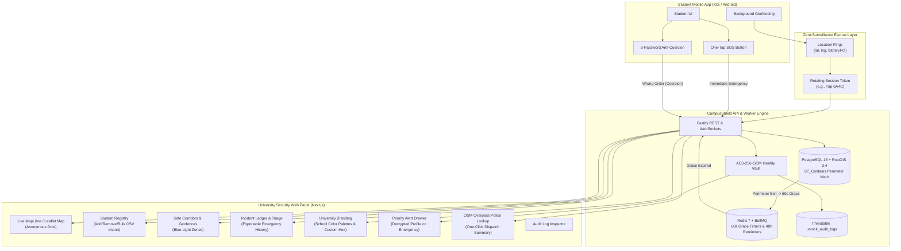

# CampusShield 🛡️

> **100% Open-Source, Self-Hostable University Student Safety Platform with Privacy-by-Default Identity Escrow**  
> *Licensed under the MIT License — Zero Paid APIs, Zero Per-Student Fees.*

---

## 🌟 Executive Summary & Motivation

Many university students—especially out-of-city and international students—frequently travel alone or in small groups at night. While safety risks in urban or transit settings are high, existing university security apps suffer from exceptionally low adoption because students feel constantly tracked and surveilled during their normal personal lives.

**CampusShield solves this fundamental conflict through a two-mode privacy architecture (Identity Escrow):**
1. **Normal Life (Zero Surveillance):** During active trips, students' phones stream GPS breadcrumbs labeled *only* with rotating anonymous tokens (e.g., `Session-7F2A`). University security dispatchers see moving dots on an OpenStreetMap interface without any names, student IDs, dorm rooms, or photos.
2. **Emergency Mode (Cryptographic Identity Unseal):** Only when an explicit trigger fires—such as an **SOS button press**, a **perimeter breach**, a **missed return deadline**, a **missed 48h wellness check-in**, or a **coerced password entry**—is the student's real profile decrypted from an AES-256-GCM vault, immediately surfacing on campus security's dispatch queue with the nearest police station lookup.
3. **Audited Transparency:** Every single decryption event writes an immutable, append-only record to `unlock_audit_logs`, protected by database-level triggers to guarantee university staff cannot snoop on students without permanent audit trails.

---

## 🏛️ System Architecture & Console Capabilities



### 🎛️ State-of-the-Art University Security Portal Modules

1. **Live Operations Map (Zero Surveillance + Verified Police Layer):**
   - Real-time OpenStreetMap / Leaflet display centered on UC Riverside (`33.9737, -117.3281`).
   - Normal student trips stream strictly as rotating anonymous tokens (`Trip-7F2A`) with zero names or photos.
   - **5 Verified Riverside Police Stations on Map:** UCR Police Department (UCPD On-Campus), Riverside Police Dept Central HQ, RPD Eastside Substation, Riverside County Sheriff's Dept, and California Highway Patrol (CHP). Each with full physical addresses, distance calculations, and direct-dial hotline buttons (`tel:(951)...`).
   - Dedicated Police Station Layer Toggle (`[🚔 Police Stations: ON (5 Verified)]`).

2. **Dual-Custody Password-Gated Identity Reveal:**
   - Even during an emergency trigger (SOS, Coercion, Perimeter Exit), the student's name remains **sealed** (`🔒 Identity Escrow Locked in AES-256 Vault`).
   - Only when an authorized dispatcher enters their **Staff Security Password** does the system decrypt and unseal the student's real name, photo, dorm, and emergency contacts.
   - Prevents unauthorized shoulder-surfing, bystander snooping, or accidental privacy leaks in campus dispatch centers.
   - Every password authorization writes an immutable audit record to `unlock_audit_logs`.

3. **Student Directory & Enrolled Registry (50+ Seeded Students):**
   - 52 realistic enrolled students across all UCR residential halls (Dundee Hall, Aberdeen-Inverness [A&I], Lothian Hall, Glen Mor Apartments, Pentland Hills, North District Apartments, Bannockburn Village, Stonehaven, Falkirk, and Plaza).
   - Detailed profile inspect drawer with vault encryption status and direct-dial emergency contacts.
   - **Bulk CSV Import & Manual CRUD:** Add, update, search, and remove student profiles in real time.

4. **1-Year Retention Policy & Emergency Incident Ledger:**
   - Preserves complete 365-day historical ledger of all resolved safety triggers, dispatch timelines, and officer verification notes in accordance with Clery Act audit guidelines.
   - Time-range selector (`All 1-Year Archive`, `Past 180 Days`, `Past 90 Days`, `Past 30 Days`).
   - One-click CSV export with `NearestPoliceStation` and `PoliceStationPhone` columns.

5. **Safe Corridors & Campus Geofencing:**
   - Pre-configured UCR boundaries: `UCR Main Campus Boundary`, `Highlander HUB & Bell Tower Safe Walk Corridor`, `Aberdeen-Inverness & Dundee Dorm Quad`, and `University Village & Canyon Crest District`.
   - Create custom safe zones with radius (meters) and automated exit alerts.

6. **University Branding & Color Palette Engine:**
   - Official **UC Riverside Blue (`#003B5C`) and Highlander Gold (`#FFB81C`)** by default.
   - Reactive CSS variable engine transforms every button, badge, active tab, and modal action across the entire portal in real time.
   - Supports Harvard/Stanford Crimson, Michigan Maize & Blue, Dartmouth Emerald, Oxford Navy, and custom hex color pickers.

---

## 🔐 3-Password Ordered Anti-Coercion Check-In

A core vulnerability in traditional safety apps is that an attacker or coercer watching over a student's shoulder can force them to enter their PIN to cancel an alert.

CampusShield prevents this through a **3-Password Factor Ordering System**:

1. **Three Distinct Factor Types:** During onboarding, each student sets:
   - **Factor 0:** Numeric PIN (4–6 digits)
   - **Factor 1:** Grid Pattern (3x3 node sequence)
   - **Factor 2:** Short Passphrase (custom words)
2. **Personal Secret Sequence:** The student designates their secret safe order, e.g. `Passphrase ➔ PIN ➔ Pattern`.
3. **Evaluation After All 3 Inputs:** All 3 factors are gathered sequentially before testing hashes, giving an observer zero mid-entry clues.
4. **Zero-Leakage Confirmation:**
   - **Honest Typo:** Any invalid password returns HTTP 401 `"Wrong password, please try again"`, preventing false police dispatches.
   - **Correct Passwords in Safe Order:** Returns HTTP 200 `{ "status": "APPROVED" }`, showing `"Approved — Checked In"` and resetting check-in timers.
   - **Correct Passwords in Wrong Order (Coercion):** Returns the **exact same** HTTP 200 `{ "status": "APPROVED" }` screen on the phone to fool the attacker—while in the background the server immediately decrypts student identity and triggers a **Priority-1 Coercion Emergency Alert** on campus dispatch.

```
       [ Student Enters 3 Factors ]
                   │
                   ▼
     Are all 3 credentials valid?
         │                    │
        NO                   YES
         │                    │
         ▼                    ▼
  [ HTTP 401 ]         Does entered order match
"Wrong password"       personal secret order?
  (Honest typo)               │          │
                             YES         NO (Under Coercion)
                              │          │
                              ▼          ▼
                       [ HTTP 200 ]   [ HTTP 200 ]
                     "Approved" screen  "Approved" screen (Deceives attacker)
                     Timer resets safely        │
                                                ▼
                                    [ PRIORITY-1 COERCION SOS ]
                                    • Decrypts student profile
                                    • Unlocks live coordinates
                                    • Dispatches nearest police station
```

---

## 🚨 Alert Escalation Matrix

| Trigger Event | Student Phone UI | Grace Window | University Panel Action |
|---|---|---|---|
| **Manual SOS** | Loud or Silent Mode confirmation | Instant (0s) | Unlocks identity + Priority-1 alert + police lookup |
| **3-Password Wrong Order** | Shows identical `"Approved"` screen | Instant (0s) | Unlocks identity + Priority-1 Coercion alert |
| **Perimeter Breach** | Loud pre-alarm vibration + prompt | 60–90 seconds | Unlocks identity if unconfirmed after 60s |
| **Late Return Deadline** | Loud pre-alarm vibration + prompt | 60–90 seconds | Unlocks identity if unconfirmed after 60s |
| **Missed Wellness Check-In** | Push notifications at -4h and -1h | 1–2 hours | Unlocks identity + Welfare Check incident |
| **Low Battery (< 5%)** | Pushes final cached GPS ping | Instant (0s) | Unlocks identity + Low Battery failsafe alert |
| **3-Password Typo** | Shows `"Wrong password, retry"` | Retries allowed | No alert dispatched (prevents false alarms) |

---

## 📦 Zero-Cost Open-Source Tech Stack

CampusShield is built 100% on open-source technologies with **zero recurring software licensing costs**:

| Component | Technology | Rationale |
|---|---|---|
| **Backend API** | Node.js 20, TypeScript, Fastify | Fast, type-safe, asynchronous event loop |
| **Real-Time WebSockets** | Socket.IO | Push updates to dispatch console in < 100ms |
| **Geofencing & Spatial** | PostgreSQL 16 + PostGIS 3.4 | High-performance spatial indexing (`ST_Contains`, `ST_Distance`) |
| **Job Timers & Queues** | Redis 7 + BullMQ | Reliable delayed grace counters and check-in reminders |
| **Cryptography** | Node.js crypto + Argon2id | AES-256-GCM identity encryption & Argon2 password hashing |
| **Security Web Panel** | Next.js 14, Tailwind CSS, Leaflet | Self-hosted web console with free OpenStreetMap tiles |
| **Student Mobile App** | React Native (Expo) | Single codebase for iOS and Android with background location |
| **Police Station Lookup** | OpenStreetMap Overpass API | 100% free OSM query for nearest emergency resources |
| **Containerization** | Docker & Docker Compose | Single-command deployment on any Linux or cloud VM |

---

## 🚀 Quick Start (Docker Deployment in 3 Steps)

### Step 1: Clone Repository & Configure Environment
```bash
git clone https://github.com/campus-shield/campus-shield.git
cd campus-shield
cp .env.example .env
```

Generate a secure 32-byte hexadecimal key for your AES-256-GCM Identity Vault:
```bash
node -e "console.log(require('crypto').randomBytes(32).toString('hex'))"
```
Paste this value into `.env` as `VAULT_ENCRYPTION_KEY`.

### Step 2: Launch Full Stack with Docker Compose
```bash
docker compose -f infra/docker-compose.yml up --build -d
```

### Step 3: Access Platforms
- **University Security Web Panel:** [http://localhost:3000](http://localhost:3000)
  - Default Dispatcher: `dispatcher@university.edu` / `CampusShield2026!`
  - Default Admin: `admin@university.edu` / `CampusShield2026!`
- **API Server & Healthcheck:** [http://localhost:3001/health](http://localhost:3001/health)

---

## 📱 Mobile App Setup (React Native / Expo)

```bash
cd apps/student-mobile
npm install
npm start
```
Use the Expo Go app on iOS or Android to scan the QR code and test on physical devices.

---

## 🧪 Running Automated Tests

```bash
cd services/api-server
npm test
```

Tests cover:
- 3-Password factor verification (valid order, coerced order, typos, duplicate factors)
- AES-256-GCM encryption/decryption round-trip and tamper detection
- PostGIS spatial perimeter containment and grace timer transitions
- Failsafe low battery (< 5%) trigger behavior

---

## 📚 Documentation
- [Security Model & Threat Matrix](docs/SECURITY_MODEL.md)
- [University IT Self-Hosting & Deployment Guide](docs/SELF_HOSTING.md)

---

## 📄 License
This project is licensed under the [MIT License](LICENSE).
